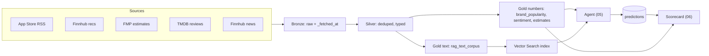
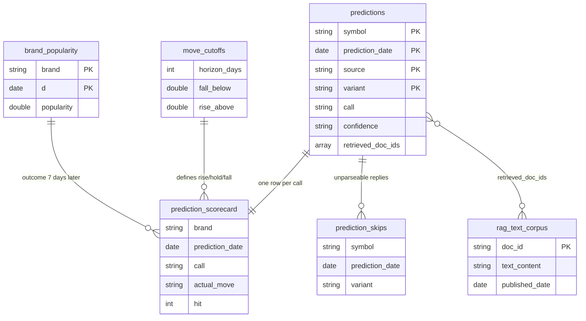
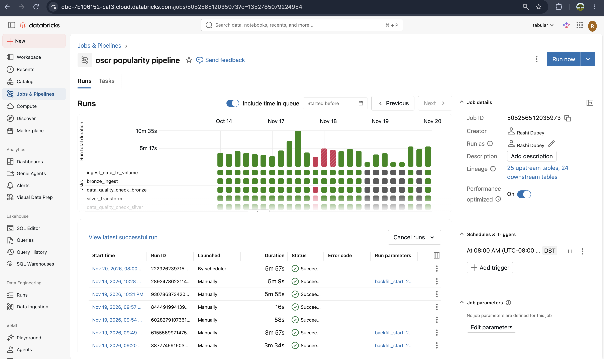
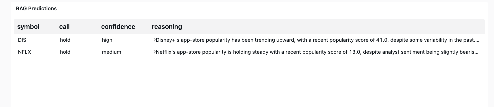
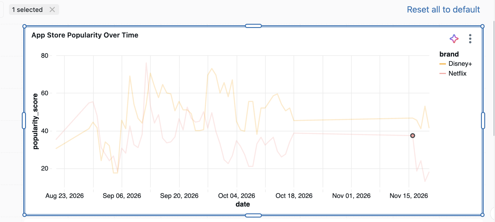
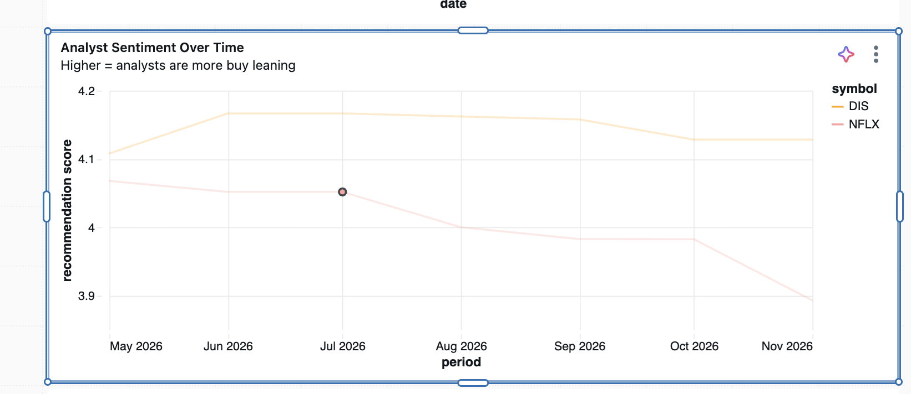
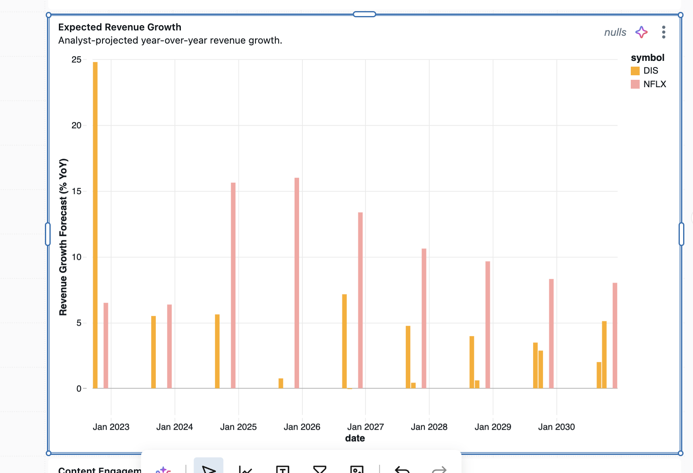
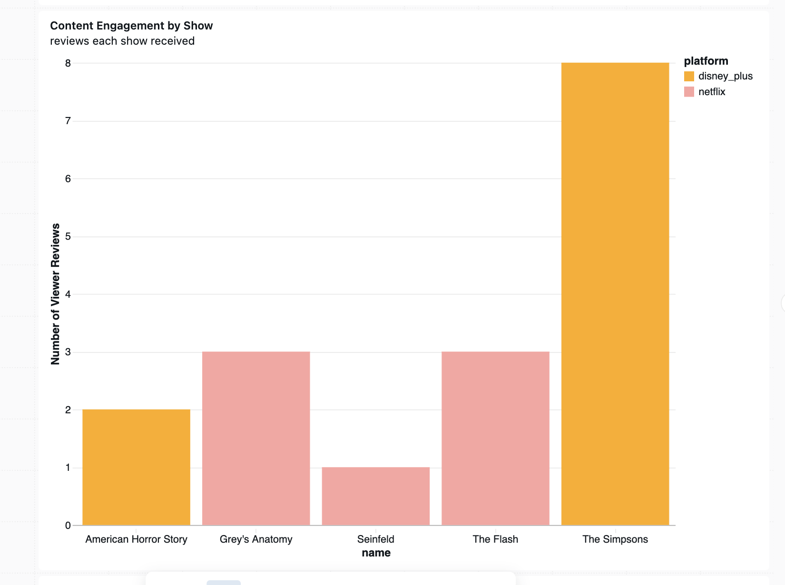

# OSCR (Online Streaming Content Radar)

A daily pipeline that tracks Netflix and Disney+ popularity, makes a rise / hold / fall call for each brand, and grades its own calls a week later.

Example: Netflix's app rank has slid for a week, analysts are cooling, and reviewers complain about a new season. The agent calls `fall` and cites those reviews. Seven days later the scorecard checks whether the rank really fell.

**Who it's for:** a streaming analyst deciding which brand's audience attention is shifting and where to dig deeper. It is not a trading signal.

Runs entirely on Databricks (Unity Catalog, Delta Lake, Mosaic AI Vector Search). Nothing to run locally.

## Data sources and what each adds

| Source | Kind | Lands in | Answers |
|---|---|---|---|
| Apple App Store RSS (US) | number | `app_rank_history`, `brand_popularity` | What changed: the rank we predict and grade |
| Finnhub analyst recommendations | number | `symbol_analyst_sentiment` | What analysts think |
| FMP analyst estimates | number | `symbol_forward_estimates` | Forward revenue and EPS expectations |
| Finnhub company news | text | `rag_text_corpus` | Why: market and news context |
| TMDB show reviews | text | `rag_text_corpus` | Why: how viewers react to shows |

Numbers say what moved. Text, retrieved with RAG, says why.

## Architecture



Gold tables and how they connect:



## Orchestration

One Databricks Workflow (`oscr popularity pipeline`) runs daily at 08:00 America/Los_Angeles. A data-quality gate sits after every layer, so a bad batch stops before the next stage.

```
ingest -> bronze -> DQ -> silver -> DQ -> gold -> DQ -> index sync -> agent -> scorecard
```

The gates check row counts, nulls, duplicate keys, empty tables, and freshness: the newest `_fetched_at` in every source must be under 36 hours old. The fetch step fails the run if a required API call fails, and a failed run sends an email.



Run history. Red cells are failed runs, grey cells are tasks that did not run (for example, runs started by hand for a single task).

## Idempotency

Every layer is safe to rerun, and each uses the strategy that fits it.

| Layer | Rerun strategy |
|---|---|
| Bronze | Recommendations and estimates append. News, reviews, registry, providers and App Store do a full refresh, but an empty load keeps the old table and fails the task. |
| Silver | Latest row per key, overwrite. App Store uses MERGE on app id and storefront. |
| Gold | Aggregates overwrite. `app_rank_history` deletes the day, then inserts. |
| Predictions | Delete then insert on (symbol, date, source, variant). |

## The agent

[`05_agent_predictions.py`](src/05_agent_predictions.py) reads the numeric signals, retrieves the most relevant reviews and news, and asks an LLM for a rise / hold / fall call on each brand's 7-day App Store popularity change. The call is written to `predictions`, a real state change in the pipeline.

- Popularity is `101 - rank` in the US App Store, flagship app only. India and Germany are excluded because they drop in and out of the feed.
- "Hold" is defined once, in `move_cutoffs`: fall below -8.33, rise above +5.0. These are the terciles of 84 pooled 7-day changes (Aug 29 to Oct 11), frozen before any scoring. The agent prompt and the scorecard both read this table.
- Every input is limited to rows dated on or before the prediction date.
- Live runs write two variants, with RAG and without, so the effect of the text can be measured.



## Does it work?

[`06_prediction_scorecard.sql`](src/06_prediction_scorecard.sql) scores each call against what happened 7 days later and compares it with simple baselines. Backfill test: 84 daily brand-dates, temperature 0, no RAG (see limits below).

| Model | n | Hit rate | 95% interval |
|---|---|---|---|
| Agent, Llama 3.1 8B | 84 | 32.1% | 23.1 to 42.7 |
| Agent, Llama 4 Maverick | 84 | 13.1% | 7.5 to 21.9 |
| Always hold | 84 | 34.5% | 25.2 to 45.2 |
| Always rise | 84 | 32.1% | 23.1 to 42.7 |
| Persistence (repeat last week's move) | 70 | 21.4% | 13.4 to 32.4 |
| Random | 84 | 25.0% | 17.0 to 35.2 |

Honest reading: no model beats the baselines, and the intervals all overlap, so none of these differences is significant.

- The 8B model answered "rise" 84 times out of 84, so it scores exactly like always-rise.
- The larger model, chosen before looking at results and run once, made mixed calls and scored worse.
- Persistence also scored below chance. That hints that rank moves partly reverse, so models that extrapolate the trend lose. This is a hypothesis for the live data, not a finding. I did not tune anything on this test set.
- Live predictions started Nov 20. The first can be scored on Nov 27.

## Dashboard



The straight segment from Oct 18 to Nov 15 is a gap: the schedule was paused and no snapshots were taken.







TMDB review counts per show. The text signal is thin: 1 to 8 reviews per show.

## What went wrong, and what I fixed

- **Look-ahead leak.** The first backtest retrieved news published after the prediction date (88 of 120 retrieved docs, affecting 22 of 24 calls). I added as-of filters to every input and threw that result away.
- **Silent outage.** From Nov 18 the daily fetch got 401 from Finnhub, FMP and TMDB because the key file had vanished, yet every run showed green and one fetch overwrote a good file with an empty one. Fixes: keys now live in a Databricks secret scope, files are replaced only on a good response, the run fails if a required call fails, bronze keeps the old table if a load is empty, and a freshness check reads the fetch timestamp.
- **Duplicate predictions.** Reruns appended twice. The write is now delete then insert on the full key.

## What I learned

- A green run is not fresh data. Check when data was fetched, not when it was loaded.
- Point-in-time correctness: every input must be dated on or before the prediction date.
- Beat the baselines first. Always-hold, always-rise, persistence and random put a hit rate in context.
- A small LLM can collapse to one answer, and a bigger one is not automatically better.
- Idempotency is designed per layer: append, MERGE and delete-then-insert answer different questions.
- RAG is for text you can't turn into a number. Retrieval ranks results, it does not filter for relevance.

## Limits

- The backfill uses numeric signals only. News before Nov 10 was not kept and FMP estimates have no publish date, so the effect of RAG can only be measured on live data, which is a small sample.
- 84 overlapping windows give wide intervals.
- No snapshots exist from Oct 18 to Nov 15.
- Only the US storefront and the two flagship apps are tracked.

## Run it

- Keys live in the Databricks secret scope `oscr` (`FINNHUB_API_KEY`, `FMP_API_KEY`, `TMDB_API_KEY`). A local `.env` is only for running the fetch outside Databricks (see `.env.example`).
- The job definition is in [`docs/workflow_job.json`](docs/workflow_job.json), with the user and email replaced by placeholders.
- Notebooks run in order from `src/`: 00 fetch, 01 bronze, 02 silver, 03 gold, 04 vector index, 05 agent, 06 scorecard. Bronze schemas are in [`docs_schema.md`](docs_schema.md) (written before the `_fetched_at` column was added).
