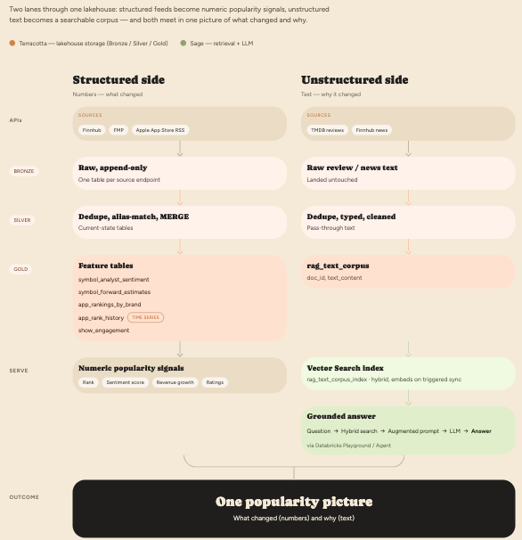
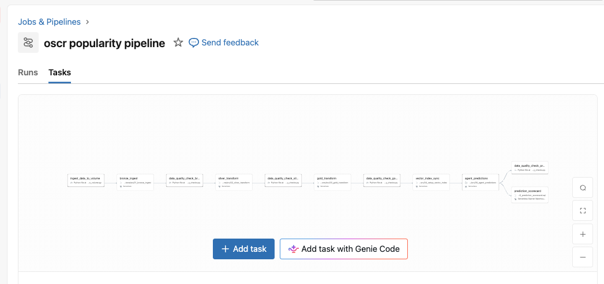
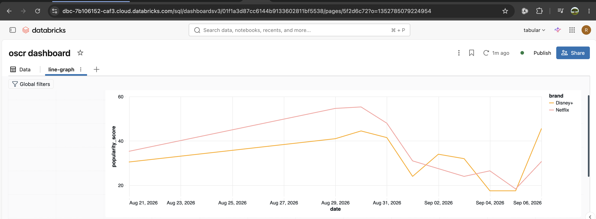
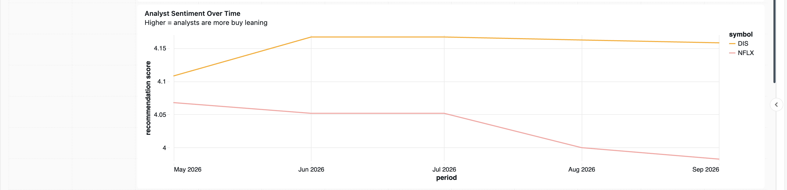
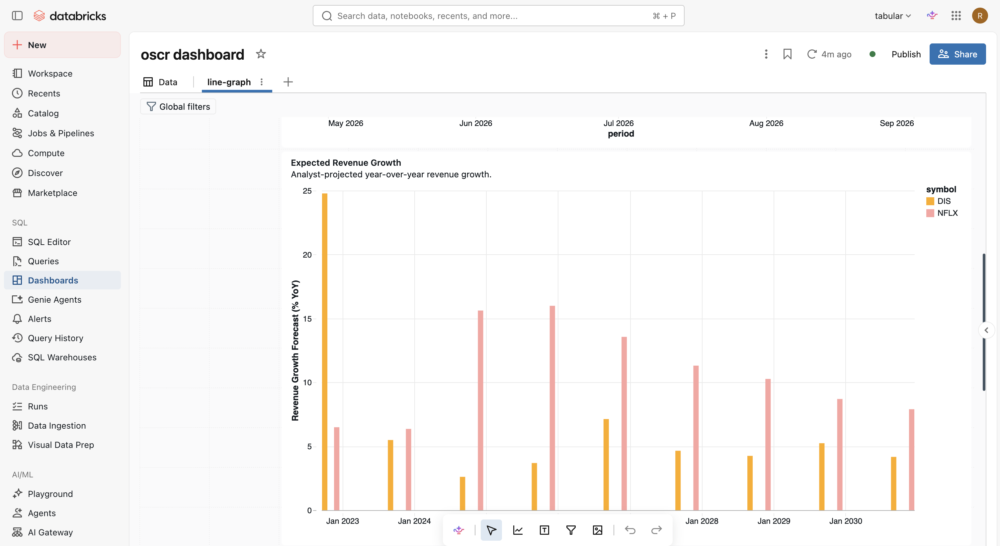

# OSCR (Online Streaming Content Radar): Streaming Content Popularity & Sentiment Pipeline

## what am I trying to achieve

Track Netflix and Disney+ popularity from three angles that don't normally
talk to each other: app-store rank, Wall Street sentiment on the parent
stock, and what viewers actually write in reviews and news. The first two
are numbers you can average into a score. The third is free text, and
that's where the RAG layer comes in. Data comes from Finnhub, Financial
Modeling Prep, TMDB, and the Apple App Store RSS feed. The output is a near-term popularity-direction call per brand (rise / hold / fall): the numbers give the direction, and the RAG layer gives a grounded why from reviews and news.

Runs entirely on Databricks: Unity Catalog, Delta Lake, Mosaic AI Vector
Search. No Docker, nothing to run locally end-to-end.

## Architecture

```
  STRUCTURED SIDE                           UNSTRUCTURED SIDE
  Finnhub, FMP, App Store RSS               TMDB reviews, Finnhub news
              |                                          |
              v                                          v
 +--------------------------+               +--------------------------+
 | BRONZE                   |               | BRONZE                   |
 | raw, append-only,        |               | raw review/news text,    |
 | one table per endpoint   |               | untouched                |
 +------------+-------------+               +------------+-------------+
              |                                          |
              v                                          v
 +--------------------------+               +--------------------------+
 | SILVER                   |               | SILVER                   |
 | dedupe, alias-match,     |               | dedupe, typed, cleaned   |
 | MERGE (current state)    |               | pass-through             |
 +------------+-------------+               +------------+-------------+
              |                                          |
              v                                          v
 +--------------------------+               +--------------------------+
 | GOLD                     |               | GOLD: rag_text_corpus    |
 | symbol_analyst_sentiment |               | (doc_id, text_content)   |
 | symbol_forward_estimates |               +------------+-------------+
 | app_rankings_by_brand    |                            |
 | app_rank_history         |                            v
 | show_engagement          |               +--------------------------+
 +------------+-------------+               | VECTOR SEARCH INDEX      |
              |                             | rag_text_corpus_index    |
              v                             | hybrid, Triggered sync   |
 +--------------------------+               +------------+-------------+
 | NUMERIC SIGNALS          |                            |
 | rank, sentiment score,   |                            v
 | growth, ratings          |               +--------------------------+
 +------------+-------------+               | AGENT / LLM              |
              |                             | hybrid search -> prompt  |
              |                             | -> grounded answer       |
              |                             +------------+-------------+
              +------------------------------------------+
                                   |
                                   v
           one popularity picture: what changed (numbers)
           and why (text)
```



## Orchestration

The whole medallion pipeline runs as a scheduled Databricks Workflow
(`oscr popularity pipeline`), with a data-quality check wired in as a
gate after every layer, so a bad batch stops the run before it reaches the
next stage:

`ingest -> bronze -> DQ(bronze) -> silver -> DQ(silver) -> gold -> DQ(gold)`

It is scheduled to run daily, and every layer is idempotent, so a rerun reconciles the data instead of duplicating it. The RAG corpus, vector index, and prediction agent all run end to end (the agent writes rise/hold/fall popularity calls to `predictions`). The schedule is currently paused; folding the agent in as the final task, so a fresh prediction lands on every run, is the remaining step.




## Idempotency

Every layer is safe to rerun, and each uses the mechanism that fits it
rather than one blanket rule.

- Bronze lands raw data with an `_ingested_at` timestamp. The recommendation
  and estimate feeds append; the news, review, registry and provider feeds
  do a full refresh (drop and reload), because the source always returns the
  full current set. Nothing downstream depends on bronze being deduped.
- Silver is where current state is enforced: it keeps the latest row per key
  by `_ingested_at` (a window plus `row_number` filter) and overwrites, so it
  reflects current state no matter how many times bronze ran. The App Store
  table uses a `MERGE` upsert instead, keyed on app id and storefront.
- Gold overwrites its aggregate tables. The one time-series table,
  `app_rank_history`, deletes the day being written before appending it, so
  backfilling a day twice never doubles it.

Rerunning the same window and watching the row counts hold steady is the
practical test of all of this, and they do.

## why RAG is here

The numeric gold tables already answer "what changed": rank moved, analyst
sentiment shifted, revenue grew. RAG exists purely to answer "why," which
lives in review and news text that can't be averaged into a score.
`rag_text_corpus` holds that text, a Vector Search index embeds it, and at
question time hybrid search pulls the most relevant chunks for an LLM to
read and answer from, grounded in real reviews instead of a guess. It's
additive: if the index or serving endpoint goes down, the rest of the
pipeline doesn't notice.

One thing worth knowing if you build on this: retrieval ranks results, it
doesn't filter for relevance. Asking for 3 results always returns 3, even
if only one is actually on-topic. The score gap between them matters more
than the row count.

Everything above is RAG that answers questions. [`04_setup_vector_index.py`](src/04_setup_vector_index.py) and [`05_agent_predictions.py`](src/05_agent_predictions.py) are the agent that acts on them. It does not forecast a number it cannot verify. Instead it reads the structured popularity and sentiment signals, retrieves the most relevant reviews and news, and produces a rise / hold / fall call on each brand's near-term app-store popularity, with a grounded explanation. That call is written to the `predictions` table, a real state change the rest of the pipeline does not have. Because popularity is something the pipeline actually measures (`app_rank_history`), the call can be checked against what happens next. Both notebooks run end to end against the live workspace: the vector index is built and synced on `oscr-rag-endpoint`, and each call is grounded in the retrieved documents plus the structured gold signals. See `docs/predictions_sample.txt` for sample output.

## what I learned

- Idempotency has to be designed per layer. Append, MERGE, and
  delete-then-insert are three different answers to "what if this reruns,"
  and each layer needs the one that fits it.
- RAG is for text you can't turn into a number. It doesn't replace the rest
  of the pipeline, and most of the real signal here still comes from
  structured data.
- A Databricks workspace and a git repo drift the moment you stop syncing
  them. Comparing the two turned up a stray notebook in the workspace
  writing bronze with `overwrite` instead of `append`, a quiet bug that only
  showed up when I diffed the two copies.
- Search results come back ranked, not filtered. Ask for 3 and you get 3,
  even if only one is relevant, so I check the score gap instead of
  trusting everything that comes back.




